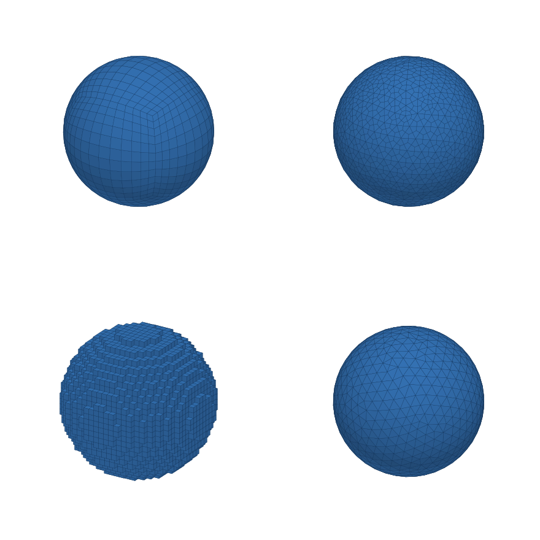
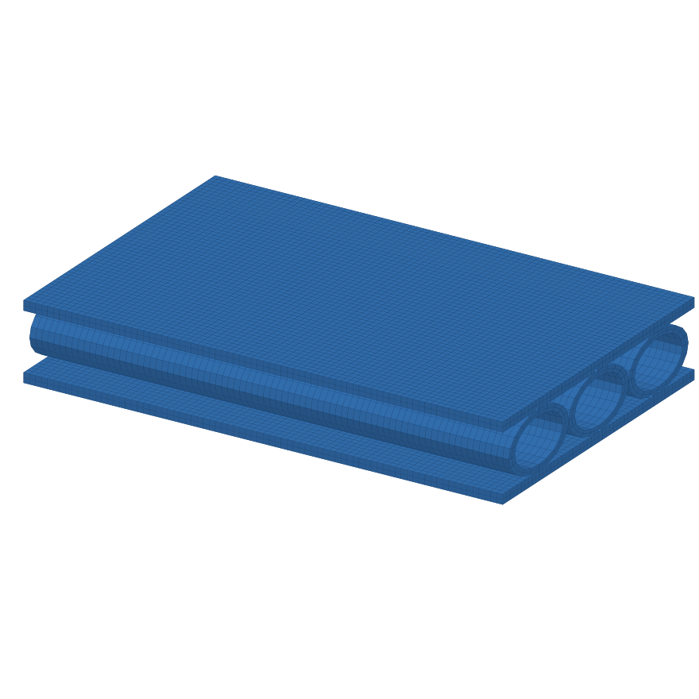
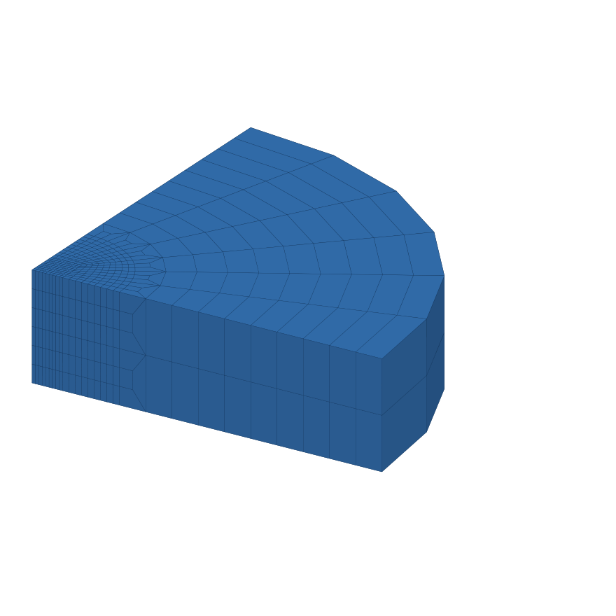
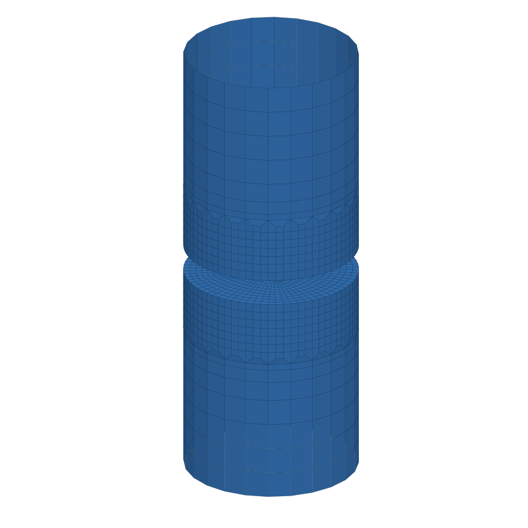
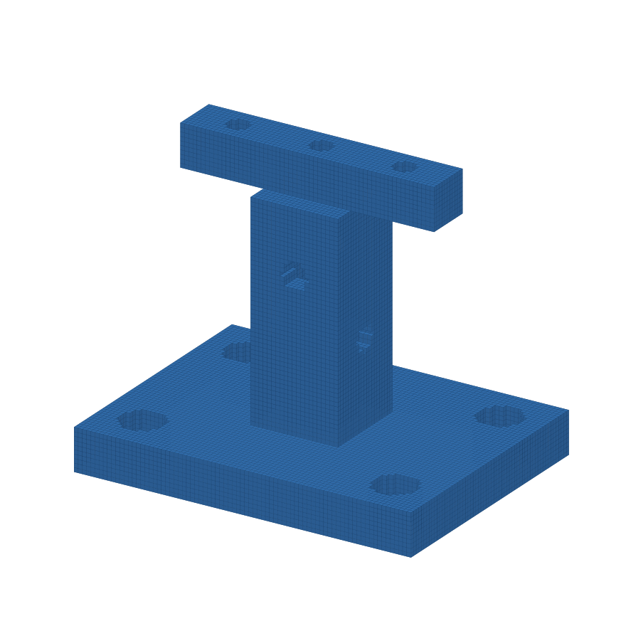
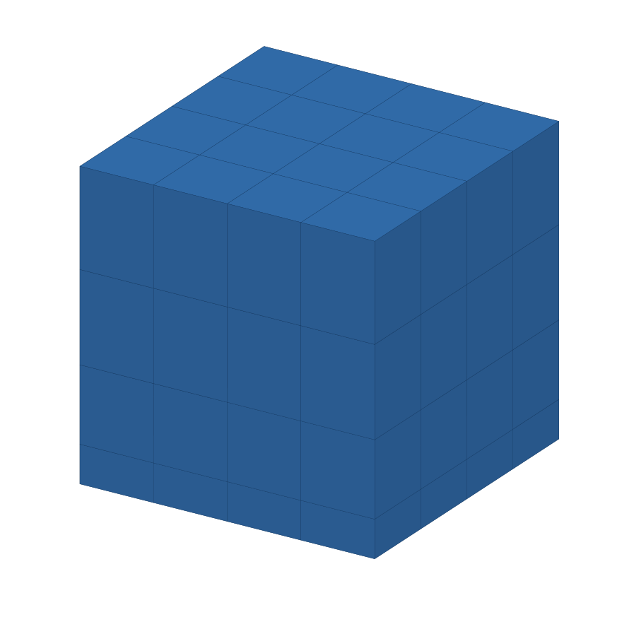
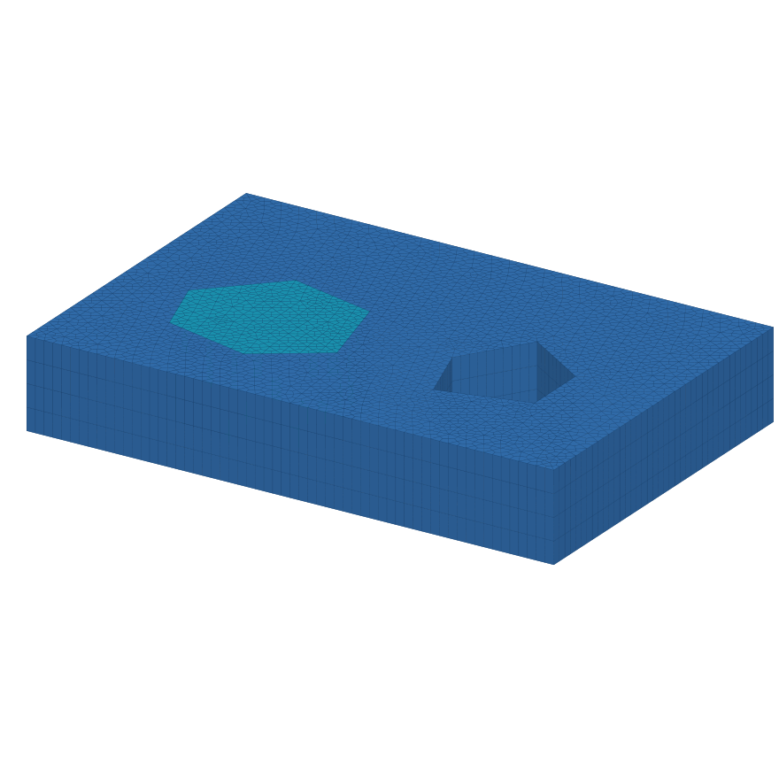
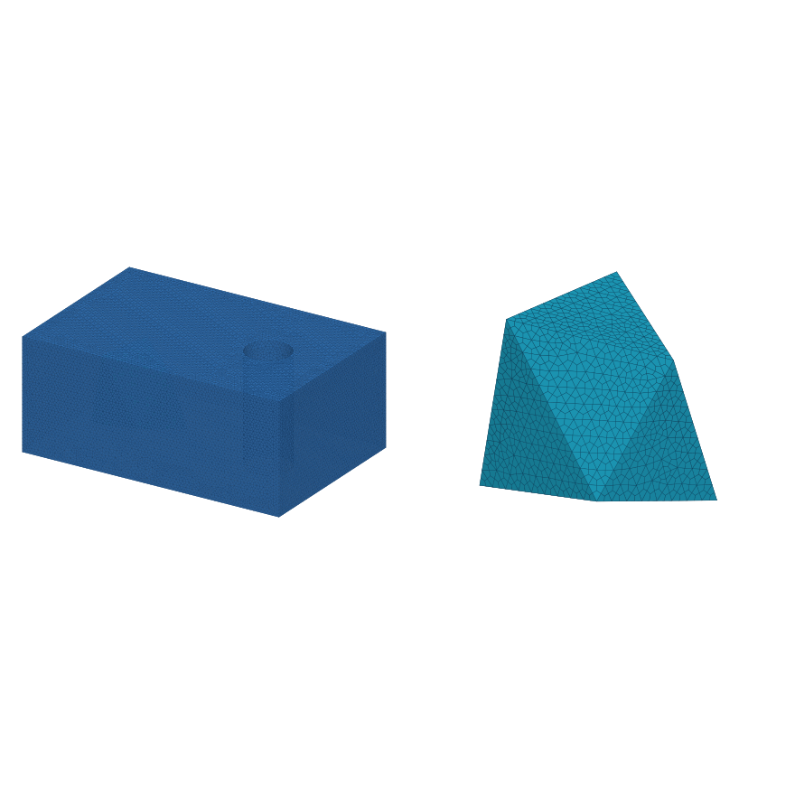
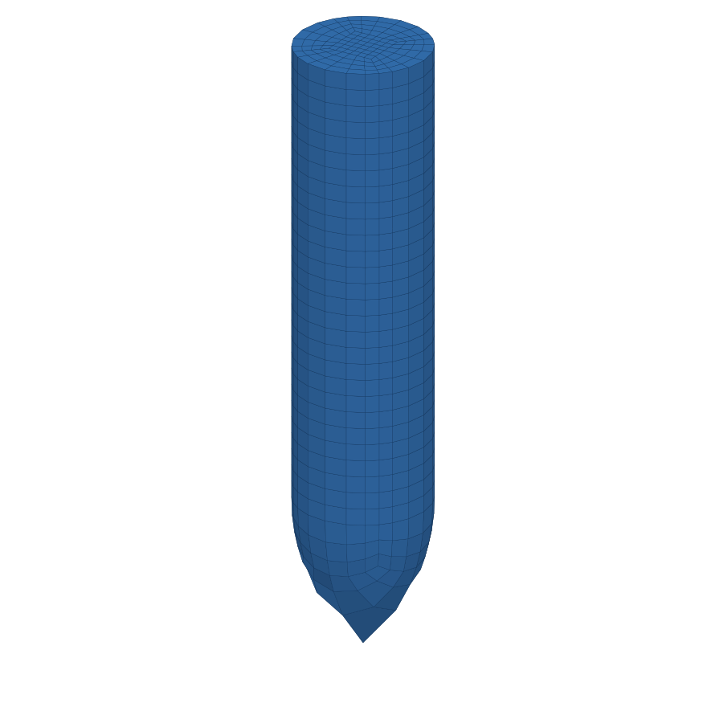
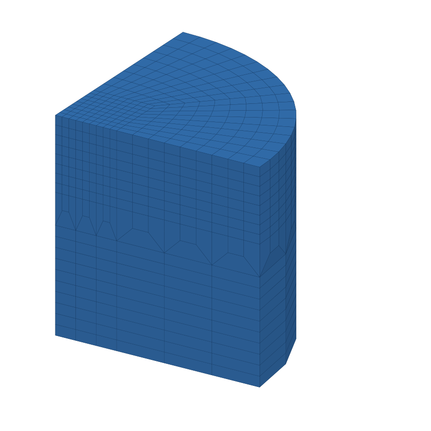

# MeshPilot

[下载 v1.0 · EXE](https://github.com/lililii124/MeshPilot/releases/download/v1.0/MeshPilot-v1.0-Setup-x64.exe)　[提示词与示例说明](examples.md)

| | |
|:---:|:---:|
|球体四种网格  |中空椭圆柱夹芯板  |
|过渡靶板  |SHPB 接触区与端部加密  |
|复杂体素结构  |网格优化  |
|2.5D 看图建模  |三维看图建模  |
|子弹已有录像：首次生成  |子弹已有录像：修正过程  |
|蝴蝶型过渡网格：已有模型  |蝴蝶型过渡网格：对话调整  |
