**连接 DeepSeek**

1. 在 [DeepSeek 开放平台](https://platform.deepseek.com/)注册并登录，确认账户有可用余额，按需充值。
2. 打开 [API 密钥页面](https://platform.deepseek.com/api_keys)，创建并复制自己的密钥。
3. 在 MeshPilot 的“设置”中选择 DeepSeek，粘贴密钥，点击“保存连接”，即可开始对话建模。

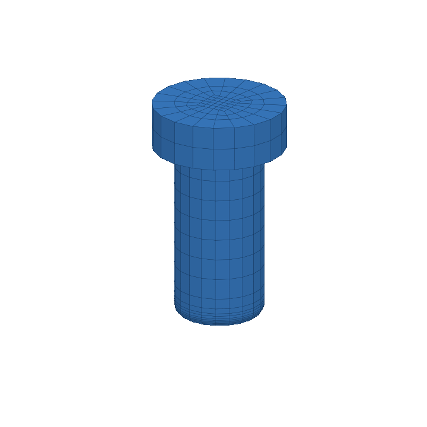
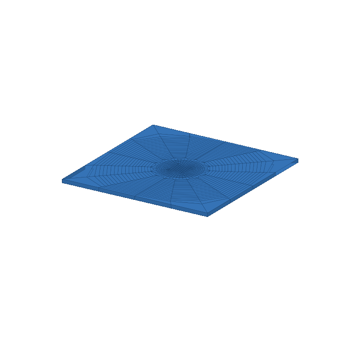

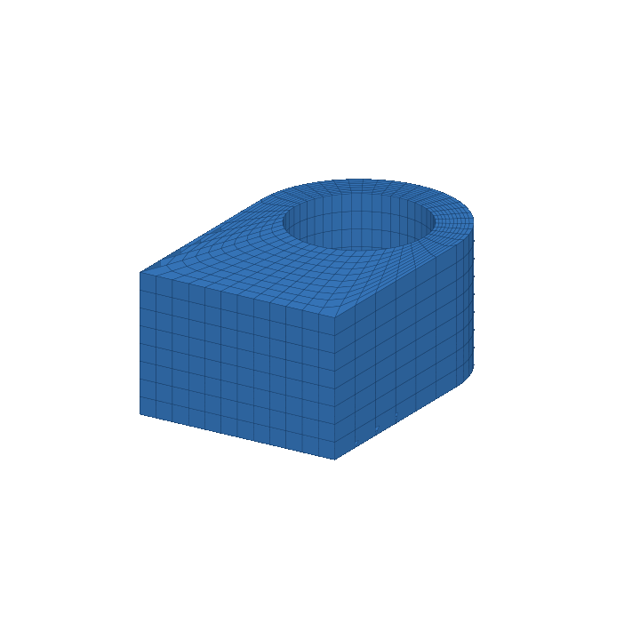
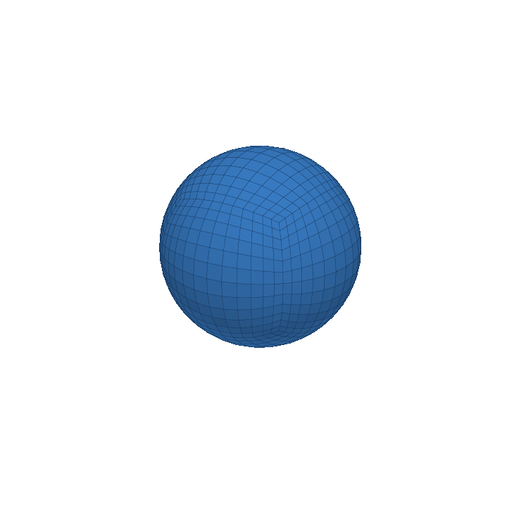

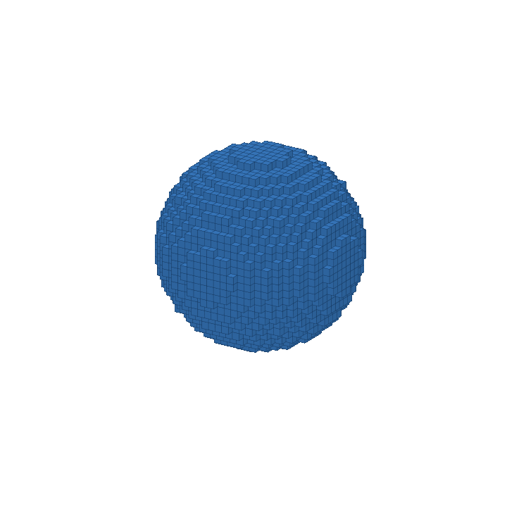

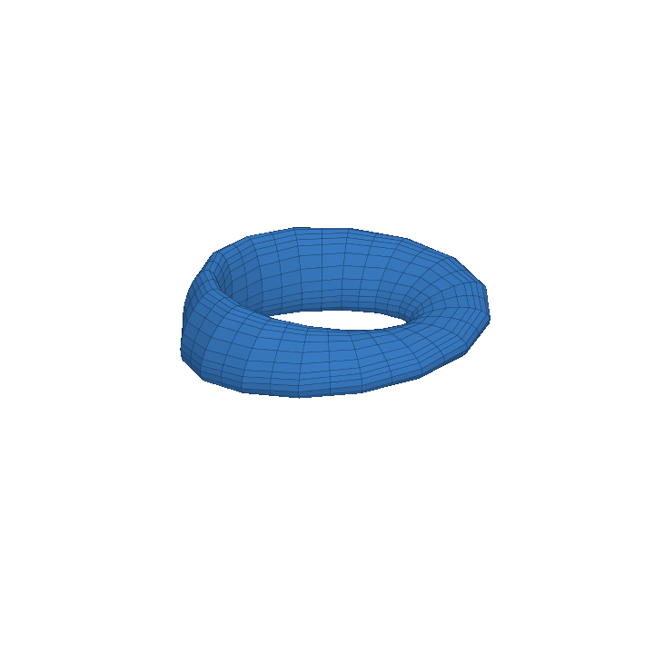
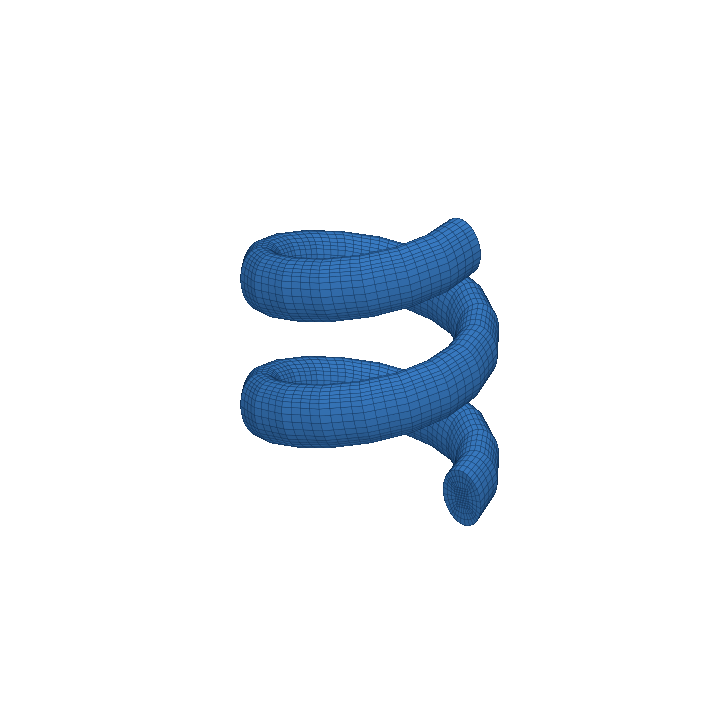

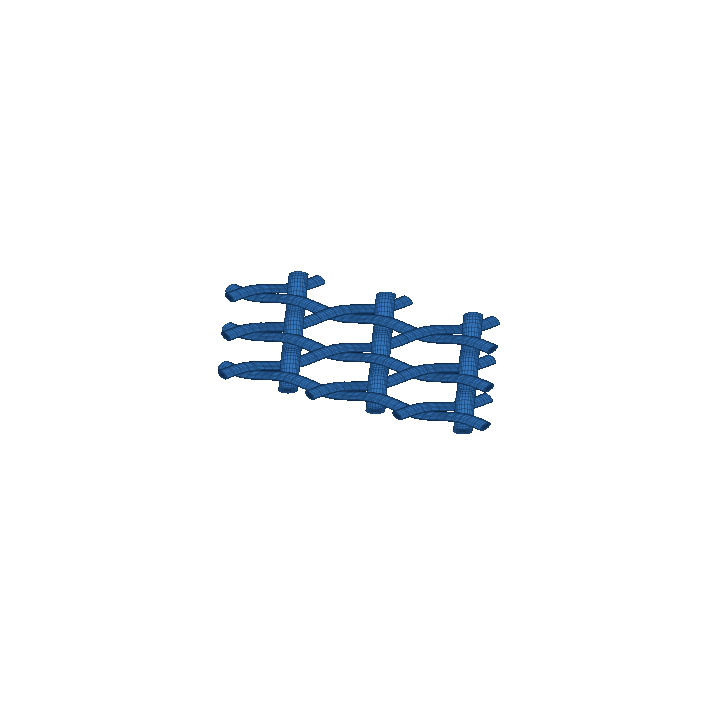
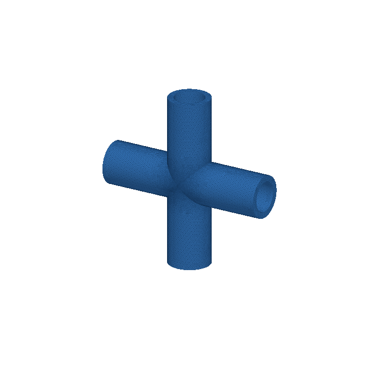

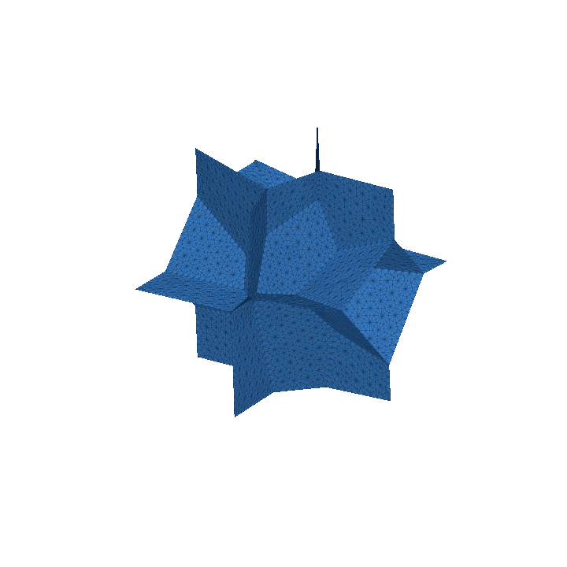
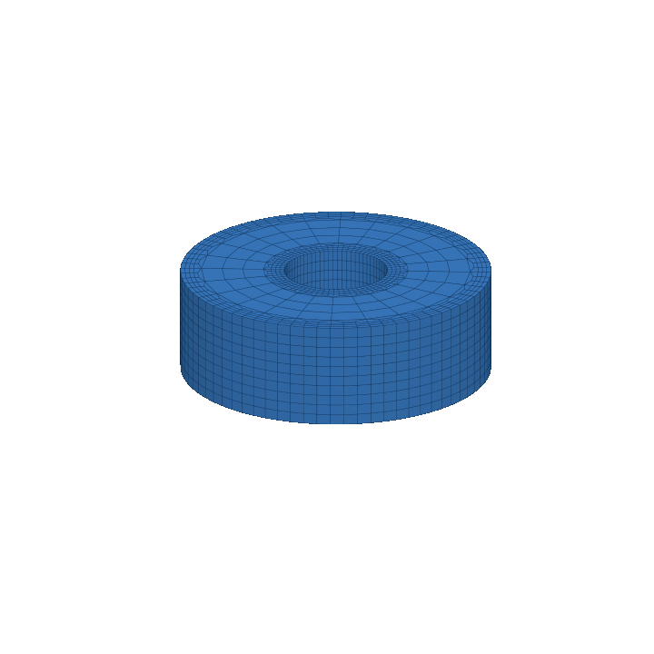

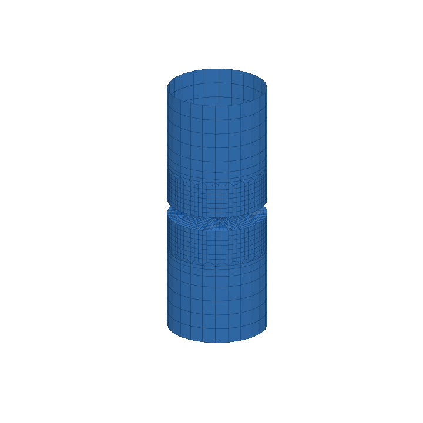

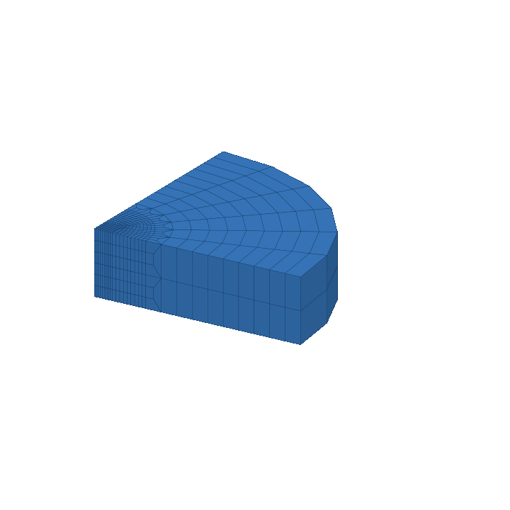
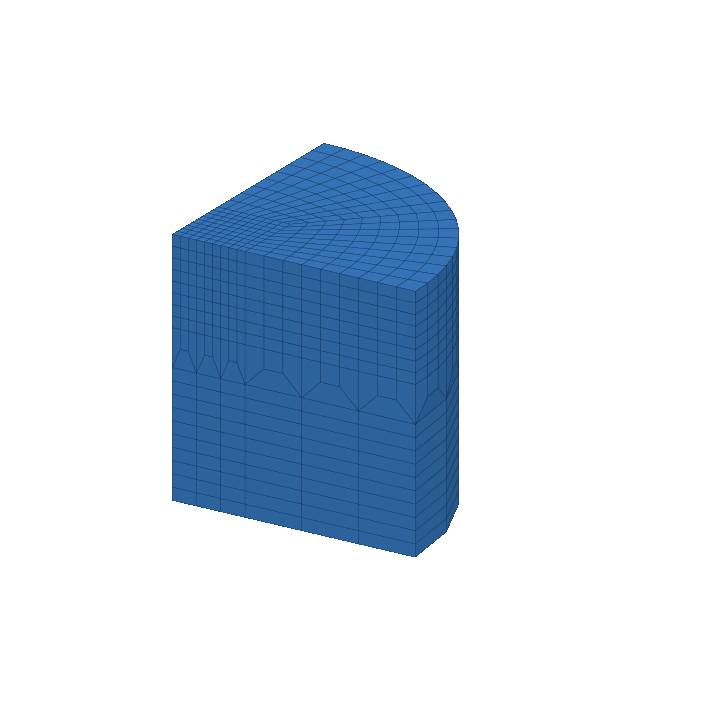

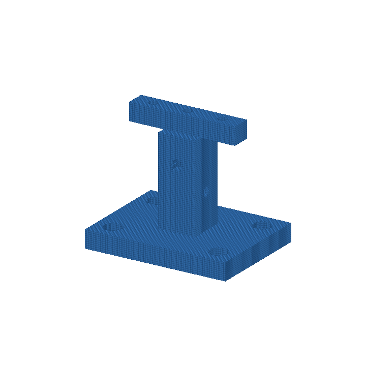
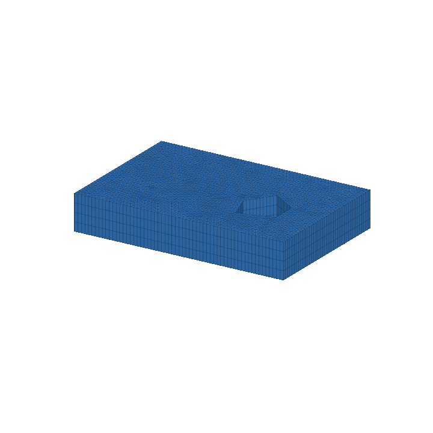

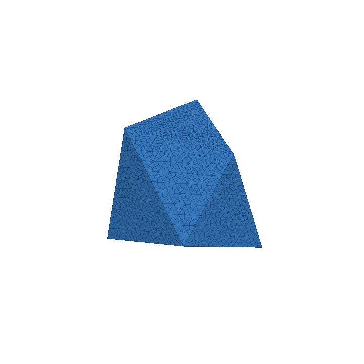
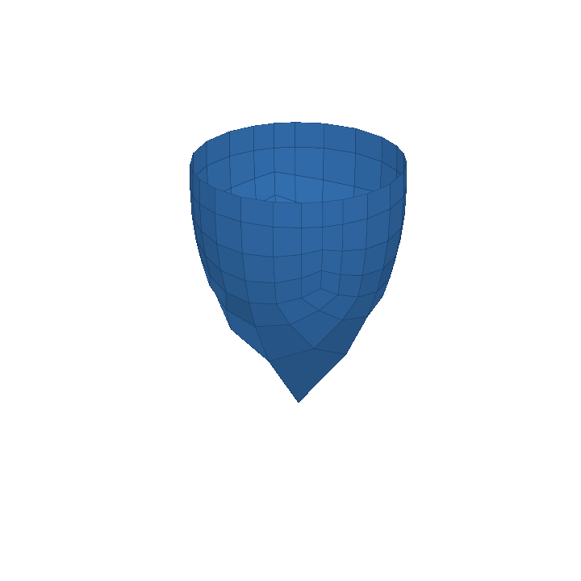

