# MeshPilot v1.0

Text2Mesh 桌面网格建模工具，通过对话或本地操作创建、修改和导出网格。

[下载 Windows 64 位安装包](https://github.com/lililii124/MeshPilot/releases/download/v1.0/MeshPilot-v1.0-Setup-x64.exe) · [示例视频与提示词](examples.md) · [完整发布页](https://github.com/lililii124/MeshPilot/releases/tag/v1.0)

安装包内置运行环境、Gmsh 和 Hexmicro，无需另装 Python 或浏览器。运行安装程序后，需要对话建模时在设置中填写自己的 API；离线建模无需 API。生成后可按需点击检查网格，再导出结果。

部分复杂案例可能预览超时，部分示例仍有未通过或未完成的检查，详见视频说明。安装包未数字签名；文件完整性及内置工具已验证，完整场景与全平台验收尚未完成。

本仓库仅提供安装包、必要说明与示例视频，不公开项目源码。逆向分析、绕过授权或套取受保护内部信息，可能导致许可证被撤销。

## 操作预览

主页直接展示动态预览，点击画面观看完整 MP4。展开每张图上方的提示词，可查看实际对话。

| | |
|:---:|:---:|
|<strong>球体四种网格</strong>

实际提示词

请直接生成球体网格：球心在原点，半径 1，无量纲。使用中央立方体加周围六个外块的蝴蝶式分块全六面体 HEX8 网格，中心立方体半边长为半径的 0.35 倍，每条中心边分 12 段，外块径向分 8 层。生成后显示网格。

使用 Hexmicro 生成一个直径为 2 的球体网格。

请直接生成球心在原点、半径为 1 的无量纲球体的体素六面体网格，体素目标尺寸 0.08。使用真实球体几何进行体素化，生成后显示网格。

请直接生成球心在原点、半径为 1 的无量纲球体的四面体网格，目标网格尺寸 0.15。使用真实球体几何，生成后显示网格。

<a href="https://github.com/lililii124/MeshPilot/releases/download/v1.0/MeshPilot-sphere-four-meshes-direct.mp4">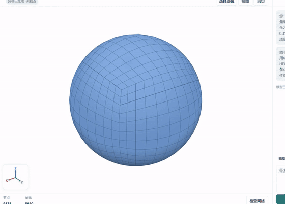</a> 四段真实对话与生成过程，等待已加速。|<strong>中空椭圆柱夹芯板</strong>

实际提示词

生成夹心板，中间为中空椭圆截面的平行柱，相切接触，柱子轴线和板子平行，六面体网格。尺寸合理选择，直接生成。

核对刚生成网格的周向划分数和总单元数，只更正说明，不重新生成。

相邻管的中心距是20，外轮廓直径也是20；它们与上下板是否相切？请区分几何接触与共享节点，简短更正说明，不改模型、不生成。

<a href="https://github.com/lililii124/MeshPilot/releases/download/v1.0/MeshPilot-sandwich-conversation.mp4">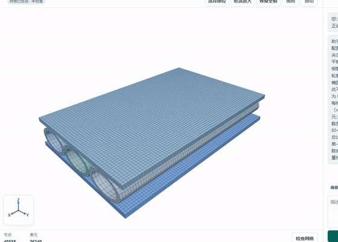</a> 包含真实对话及随后对接触含义的说明更正。|
|<strong>过渡靶板</strong>

实际提示词

生成四分之一圆形过渡靶板，半径 40、厚度 12，x 和 y 均非负，厚度从 z=-12 到 0；半径 10 内采用细网格，外环逐步变粗，接口使用共节点的 3:1 六面体过渡。

请直接生成网格。半径10处的内外网格节点没有逐一重合，请修复为共节点连接；3:1过渡需要同时作用于周向和厚度方向。保持外半径40、厚度12，x和y非负，z从-12到0，全部六面体。

简短说明当前网格在周向和厚度方向的3:1过渡及共节点连接，不改模型、不重新生成。

<a href="https://github.com/lililii124/MeshPilot/releases/download/v1.0/MeshPilot-transition-panel-conversation.mp4">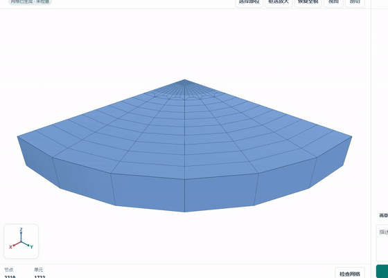</a> 包含中断后续录；加速与续录已标注。|<strong>SHPB 接触区与端部加密</strong>

实际提示词

建立同轴两杆与中间圆柱试件：两杆半径10、长度各1500，试件半径2.5、长度3，两端分别与杆接触，保持三个独立部件。试件接触面附近和两杆外端都加密，向杆身以共节点3:1过渡，采用蝴蝶分块全六面体网格。

接触面和外端的细截面应比杆身粗截面在两个方向各多3倍单元，用共节点拓扑过渡连接，而不仅是轴向步长1变3。保留三部件和已有尺寸，直接生成完整网格。

接触面和外端的细截面应比杆身粗截面在两个方向各多3倍单元，用共节点拓扑过渡连接，而不仅是轴向步长1变3。保留三部件和已有尺寸，直接生成完整网格。

保留尺寸与接触，把两根杆的截面改为中心方块加外围分块的蝴蝶布局，并保持两端加密、截面12到36段的共节点3:1过渡，直接生成完整网格。

检查发现过渡区有扁平单元；保持杆和试件尺寸、接触与12到36截面分段不变，将两端每处过渡带轴向长度缩短至1.5，并调整相邻细端和粗段使连接平顺，保持两杆总长度及外端位置，重新生成。

检查发现过渡带与杆身交界处轴向单元厚度从0.75直接跳到3，产生4倍尺寸突变。请保持四处过渡带长1.5、12到36截面分段、蝴蝶分块以及三个部件的尺寸和接触位置不变，在杆身靠近每个接口的部分设置共节点的轴向逐层加大：第一层0.75或其他合适尺寸，逐渐增大至3，确保相邻层尺寸比不超过3，并调整后续粗杆身使总长与外端位置不变。重新生成完整网格。

<a href="https://github.com/lililii124/MeshPilot/releases/download/v1.0/SHPB-public.mp4">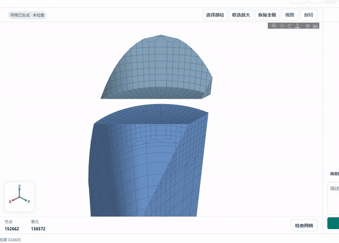</a> 包含接触区、端部和过渡区局部查看。数值与拓扑检查通过，独立 CAD 连通性期望未检查，整体状态为未完成。|
|<strong>复杂体素结构</strong>

实际提示词

请保持当前结构和所有几何尺寸不变，将体素网格目标尺寸调整为 1，并直接生成网格。

<a href="https://github.com/lililii124/MeshPilot/releases/download/v1.0/MeshPilot-complex-voxel-conversation.mp4">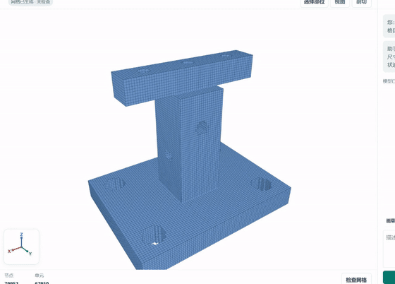</a> 从已有模型开始，记录对话修改与生成；中断后为同一任务续录。|<strong>网格优化</strong>

实际提示词

请生成一个普通实心立方块的六面体网格，范围 x、y、z 均为 0 到 4，无量纲。x、y 两方向各分 4 段；z 方向保持 4 层，层面坐标严格为 0、0.1、1.4、2.7、4，让最底层与相邻层厚度明显不均匀。显示生成的网格。

刚才手动检查发现相邻层尺寸比最大为 13，超过阈值 3。请按检查结果优化层间距并平顺连接，保持块体边界、体积、共节点连接和各方向原有单元数不变；请重新生成供我再次检查，不要修改质量检查阈值。

<a href="https://github.com/lililii124/MeshPilot/releases/download/v1.0/MeshPilot-layer-optimization.mp4">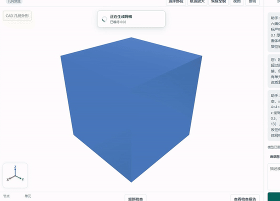</a> 实际检查截图补充于录屏之后；优化后部分检查未完成。|
|<strong>2.5D 看图建模</strong>

实际提示词

请按图中的尺寸、凸形夹杂和贯穿空孔，用 Hexmicro 的 2.5D 模式生成三维六面体网格。

请更正刚才的表述：图中 A 夹杂是六边形，不是五边形。只更正说明，保持模型和网格不变。

<a href="https://github.com/lililii124/MeshPilot/releases/download/v1.0/vision-25d.mp4">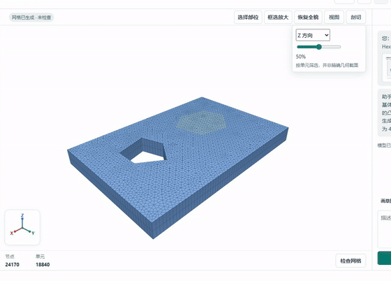</a> 几何、质量和三种格式导出回读通过。|<strong>三维看图建模</strong>

实际提示词

请按图中的尺寸、凸多面体夹杂和贯穿空孔，用 Hexmicro 的 3D 模式生成三维六面体网格。

<a href="https://github.com/lililii124/MeshPilot/releases/download/v1.0/vision-3d.mp4">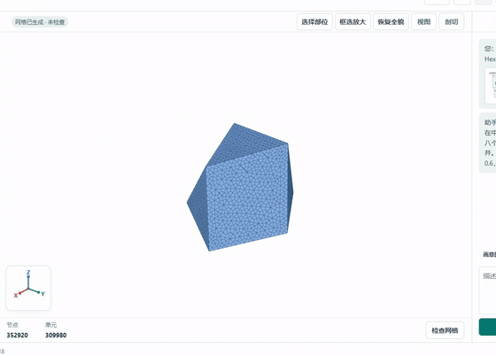</a> 几何与导出通过；3处尺寸过渡超标，部分严格质量认证未完成。此片保留演示，不标为全面验收通过。|
|<strong>子弹已有录像：首次生成</strong>

实际提示词

生成一个绕 Z 轴旋转的弹丸：头部剖面从 (半径0，z=0.2) 到 (半径3.1，z=6.85) 为半径9的短圆弧，圆心位于有向弦左侧；主体半径3.1，尾端 z=28.25。使用内部共节点的分块六面体网格。保留尖点，不截平。

<a href="https://github.com/lililii124/MeshPilot/releases/download/v1.0/bullet-first.mp4">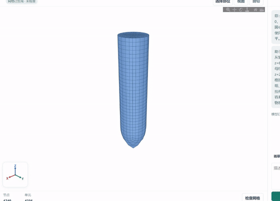</a> 保留原始过程：几何核验未通过，未确认包含尖端真实框选放大。|<strong>子弹已有录像：修正过程</strong>

实际提示词

刚生成的尖点实际在 z=-0.09455，偏离了要求。请用原有端点和半径精确求圆弧：尖点 z=0.2、肩部 z=6.85 且半径3.1、圆弧半径9，尾端保持 z=28.25。核对方向并重新生成共节点六面体网格。

<a href="https://github.com/lililii124/MeshPilot/releases/download/v1.0/bullet-correction.mp4">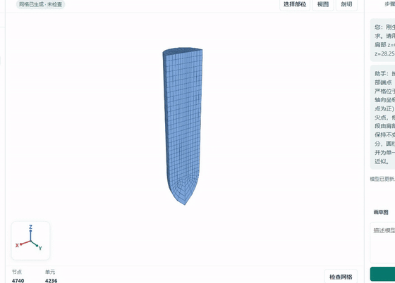</a> 生成、导出及数值质量检查通过；几何覆盖核验仍有未通过项，未确认包含尖端真实框选放大。|
|<strong>蝴蝶型过渡网格：已有模型</strong>

实际提示词

从已有模型开始，使用界面生成、查看和检查；此段没有新建模型的对话提示词。

<a href="https://github.com/lililii124/MeshPilot/releases/download/v1.0/MeshPilot-butterfly-transition.mp4">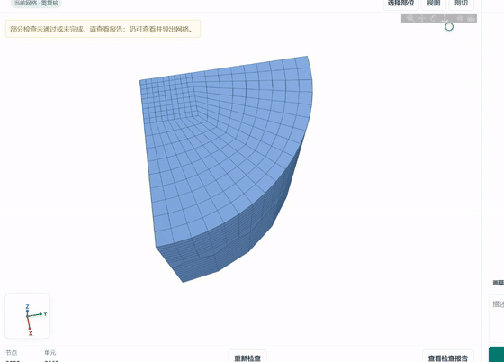</a> 已有模型的生成、剖面、检查和导出；质量总状态未完成。|<strong>蝴蝶型过渡网格：对话调整</strong>

实际提示词

请保持当前模型的所有几何、分块、网格参数和尺寸完全不变，重新生成现有六面体网格，并简要说明几何上从粗到细的过渡方式。请直接生成网格，回复只说明模型与过渡，不涉及软件内部信息。

<a href="https://github.com/lililii124/MeshPilot/releases/download/v1.0/MeshPilot-butterfly-chat-adjustment.mp4">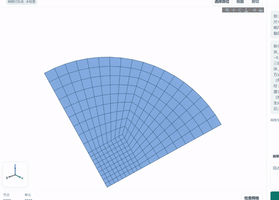</a> 在已有模型上进行真实对话调整，生成后的质量尚未检查。|
